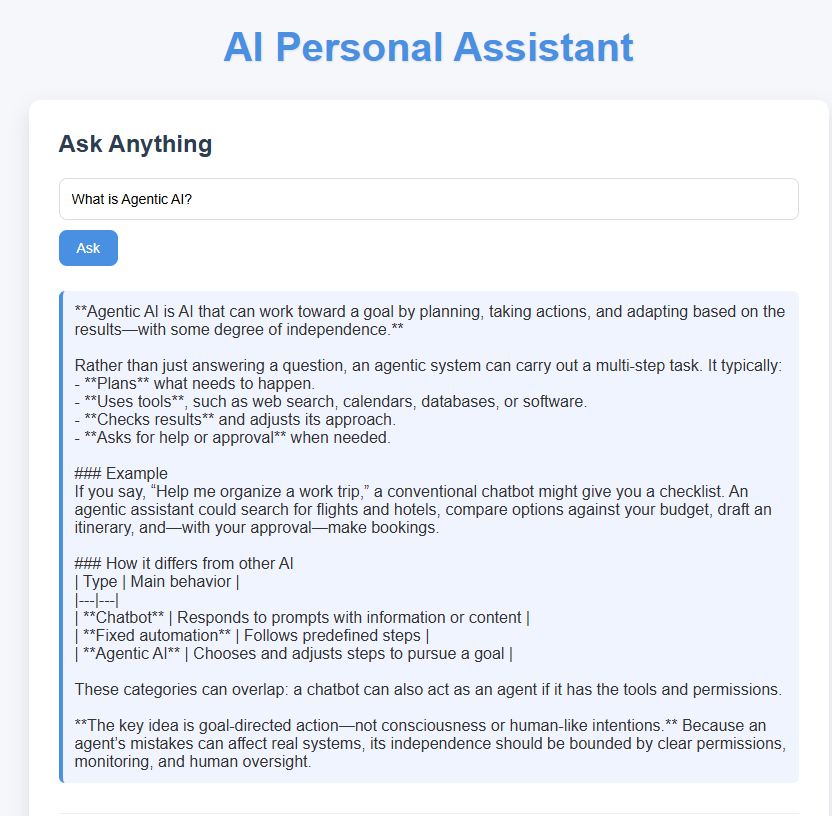
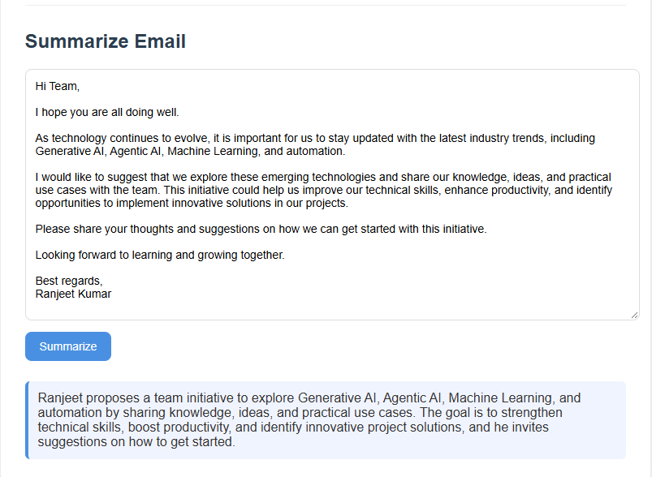

# 🤖 AI Personal Assistant Using OpenAI API | Generative AI

A Python-based AI Personal Assistant built using the **OpenAI API and Flask** that provides intelligent question answering and automatic email summarization through a simple web interface. The application uses role-based prompts to generate relevant responses for different tasks.

## 📌 Project Overview

The AI Personal Assistant supports two core functionalities:

- **Ask Anything:** Answers general questions using a Generative AI model.
- **Summarize Email:** Converts lengthy emails into concise summaries while preserving the key information, purpose, and action items.

The project demonstrates practical applications of Large Language Models (LLMs), prompt engineering, API integration, and web application development.

## 📸 Application Screenshots

### Ask Anything


### Summarize Email



## ✨ Key Features

- 🤖 AI-powered question answering
- 📧 Automatic email summarization
- 🧠 Role-based system prompts for task-specific responses
- ✍️ Prompt engineering for relevant and concise outputs
- ⚙️ Configurable response length using token limits
- 🌐 Interactive web interface
- 🚀 Flask-based backend
- 🔐 Environment variable support for API key management

## 🛠️ Tech Stack

| Category | Technologies |
|---|---|
| Programming Language | Python |
| Generative AI | OpenAI API |
| AI Concepts | LLMs, Prompt Engineering, System Prompts |
| Backend Framework | Flask |
| Frontend | HTML, CSS |
| API Integration | OpenAI Python SDK |
| Configuration | python-dotenv |
| Development Tools | VS Code, Git, GitHub |

## 🏗️ Project Architecture

```text
                 User
                  |
                  v
          Web Interface
          (HTML + CSS)
                  |
                  v
           Flask Backend
                  |
          +-------+-------+
          |               |
          v               v
      Ask Anything    Summarize Email
          |               |
          v               v
     System Prompt    Summarization
          |               Prompt
          +-------+-------+
                  |
                  v
             OpenAI API
                  |
                  v
          Generated Response
                  |
                  v
          Display in Browser
```

## 📂 Project Structure

```text
AI-Personal-Assistant/
│
├── templates/
│   └── index.html          # Web interface
│
├── static/                 # CSS and frontend assets (if used)
│
├── app.py                  # Flask application and AI logic
│
├── .env.example            # Example environment configuration
├── .gitignore              # Files excluded from Git
├── requirements.txt        # Python dependencies
└── README.md               # Project documentation
```

*Note: Adjust the folder structure to match your actual repository.*

## ⚙️ Setup and Installation

### 1. Clone the repository

```bash
git clone https://github.com/ranjeetRai25/AI-Personal-Assistant.git
cd AI-Personal-Assistant
```

### 2. Create a virtual environment

```bash
python -m venv venv
```

Activate the environment on Windows:

```bash
venv\Scripts\activate
```

For Linux/macOS:

```bash
source venv/bin/activate
```

### 3. Install dependencies

```bash
pip install -r requirements.txt
```

### 4. Configure the OpenAI API key

Create a `.env` file in the project root directory:

```env
OPENAI_API_KEY=your_openai_api_key_here
```

Load the API key securely in Python using `python-dotenv`. Never commit your actual `.env` file or expose your API key in your source code.

### 5. Run the application

```bash
python app.py
```

Open your browser and visit:

```text
http://127.0.0.1:5000
```

*The default URL assumes your Flask application runs on port 5000.*

## 💻 Application Modules

### 1. Ask Anything

Allows users to enter a question and receive an AI-generated response.

**Workflow:**
1. User submits a question.
2. Flask processes the request.
3. A role-specific prompt is sent to the OpenAI API.
4. The generated answer is displayed on the web interface.


### 2. Summarize Email

Summarizes long emails into concise, readable content while retaining the main message and important details.

**Workflow:**
1. User pastes the email content.
2. The application constructs a summarization prompt.
3. The OpenAI API generates a concise summary.
4. The summary is displayed on the page.

## 🧠 Generative AI Concepts Demonstrated

- **Large Language Models (LLMs):** Generate natural-language responses.
- **Prompt Engineering:** Guides the model toward the desired response.
- **System Prompts:** Establish different behaviors for question answering and email summarization.
- **Token Management:** Controls response length through model parameters.
- **API Integration:** Connects the Flask application to an external AI model.
- **Task-Oriented AI:** Uses different prompts to support multiple application functions.

## 🔒 Security Considerations

- Store API keys in environment variables.
- Add `.env` and virtual environment folders to `.gitignore`.
- Validate user input before sending API requests.
- Handle API errors and rate limits appropriately.
- Avoid submitting confidential emails or sensitive information without authorization.

## 🚀 Future Enhancements

- Add conversation history and contextual memory.
- Support PDF and DOCX document summarization.
- Implement Retrieval-Augmented Generation (RAG).
- Add speech-to-text and text-to-speech capabilities.
- Integrate email services for automated email processing.
- Containerize the application using Docker.
- Deploy the application to a cloud platform.
- Implement automated testing and CI/CD.

## 🎯 Learning Outcomes

Through this project, I gained practical experience in:

- Integrating LLMs into Python applications.
- Designing prompts for different AI tasks.
- Developing web applications using Flask.
- Connecting frontend interfaces with backend services.
- Managing API credentials securely.
- Building practical Generative AI applications.

## 👨‍💻 Author

**Ranjeet Kumar**

Embedded Software Engineer transitioning into AI/ML and Generative AI Engineering.

**Technical Interests:** Python | Machine Learning | Deep Learning | NLP | LLMs | Generative AI | Agentic AI

## ⭐ Acknowledgements

- [OpenAI API Documentation](https://platform.openai.com/docs)
- [Flask Documentation](https://flask.palletsprojects.com/)
- [Python Documentation](https://docs.python.org/3/)

---

⭐ If you find this project useful, consider giving the repository a star!


